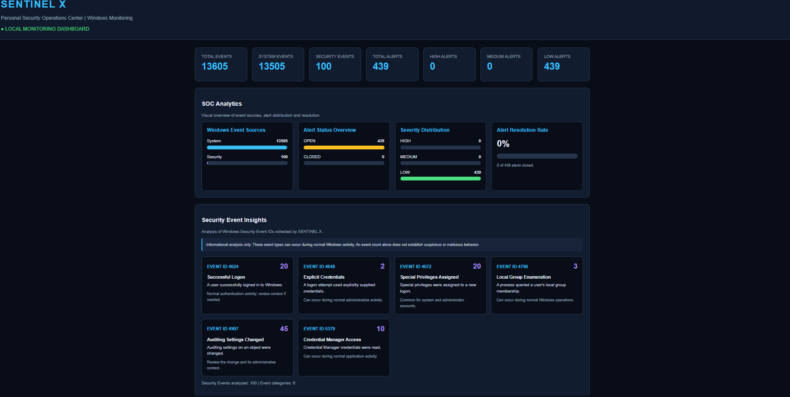

# SENTINEL X

**Personal Security Operations Center | Windows Monitoring**


SENTINEL X is a local Windows security monitoring and SOC analytics portfolio project built with Python. It collects selected Windows Event Logs, stores event metadata in SQLite, applies predefined detection rules, manages alerts, and presents monitoring information through a local web dashboard.

> **Scope:** SENTINEL X is designed for defensive monitoring on the local Windows machine. Event counts and individual event IDs provide context, but do not by themselves prove malicious activity.

## Features

- Windows System and Security event collection
- SQLite database storage
- Rule-based detection engine
- Local SOC monitoring dashboard
- Alert search and filtering
- Alert status management (OPEN / CLOSED)
- Activity history
- SOC analytics
- Event source analytics
- Security Event Insights
- CSV report generation
- Professional and executive reports
- Detector rule tests

## Architecture

```text
Windows Event Logs
       |
       v
    Collector
       |
       v
 SQLite Database
       |
       +------> Detection Engine
       |               |
       |               v
       |             Alerts
       |               |
       v               v
       Local Dashboard
              |
              v
         SOC Analytics
              |
              v
          CSV Reports
```

## Technology Stack

- Python
- SQLite
- HTML
- CSS
- JavaScript
- PowerShell
- Windows Event Logs

## Project Structure

```text
SENTINEL-X/
|-- collector.py
|-- detector.py
|-- dashboard.py
|-- watcher.py
|-- report.py
|-- executive_report.py
|-- test_detector.py
|-- README.md
|-- .gitignore
|-- reports/
```

## Requirements

- Windows
- Python 3
- Access to the Windows Event Logs being monitored

Reading the Security event log may require running Command Prompt as Administrator.

## Getting Started

Open Command Prompt and navigate to the project directory:

```cmd
cd C:\Users\user\Documents\SENTINEL-X
```

Start the local dashboard:

```cmd
python dashboard.py
```

Open the dashboard:

```text
http://127.0.0.1:8765
```

The dashboard is intended for local access. Do not expose its port to the public internet.

## Data Collection

Run the collector:

```cmd
python collector.py
```

For periodic collection and detection:

```cmd
python watcher.py
```

## Reporting

Generate a professional CSV report:

```cmd
python report.py
```

Generate an executive SOC report:

```cmd
python executive_report.py
```

Generated reports are stored in the local `reports/` directory.

## Security Event Insights

The dashboard provides informational summaries for selected Security event IDs:

| Event ID | Informational meaning |
|---|---|
| 4624 | Successful logon |
| 4648 | Logon using explicit credentials |
| 4672 | Special privileges assigned to a logon |
| 4798 | Local group membership enumeration |
| 4907 | Auditing settings changed |
| 5379 | Credential Manager credentials were read |

These events can occur during normal Windows operation. Review surrounding context before treating an event as suspicious.

## Testing

Run the detector tests:

```cmd
python test_detector.py
```

## Security and Privacy

- Designed for defensive, local Windows monitoring.
- Keep the dashboard bound to localhost.
- Do not publish real Windows event logs, databases, exported reports, credentials, or personal information.
- Use synthetic data for public demonstrations.
- Review alerts in context; an alert is a lead for investigation, not a definitive conclusion.

## Project Purpose

SENTINEL X is a personal cybersecurity learning and portfolio project demonstrating Windows event collection, rule-based detection, alert management, dashboard analytics, testing, and security reporting.
